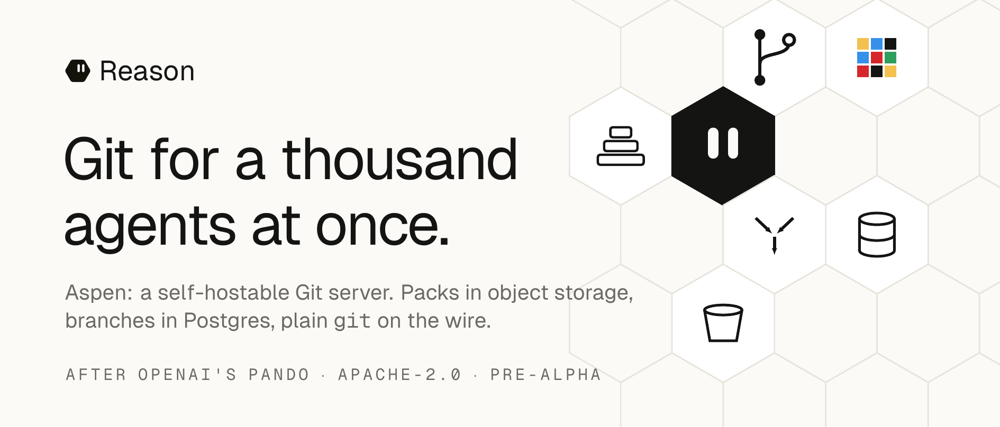
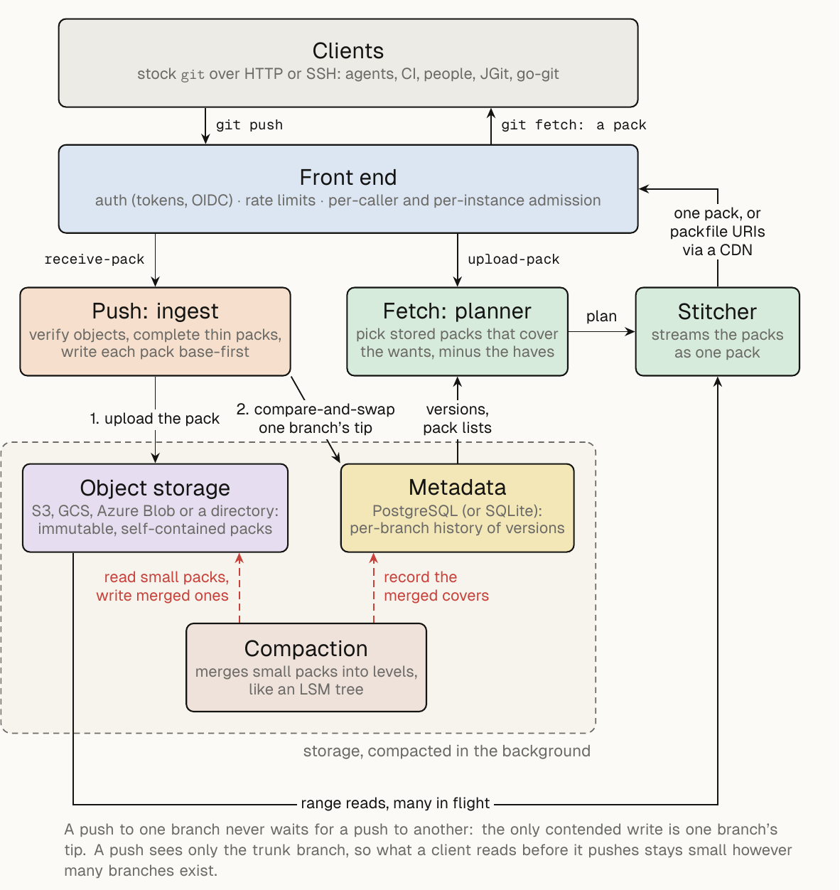

# Aspen



Aspen is a Git server you run yourself, built for repositories that hundreds
of agents, CI jobs and people push to and fetch from at the same time. It
speaks plain Git over HTTP and SSH, so stock `git` works with no client
changes. It stores packs in object storage, keeps branch history in
PostgreSQL, and runs on one machine or on any cloud.

> **Status: pre-alpha.** Aspen works end to end, but it has not passed its
> own launch gate, there are no published releases, and storage formats may
> still change. Do not put data you cannot afford to lose in it yet. See
> [Pre-alpha status](#pre-alpha-status) for exactly what is and is not
> verified.

**Live demo:** <https://place.reasonmachines.com>, a shared pixel canvas
where every brush stroke is a `git push`
([mirror on GitHub](https://github.com/reason-machines/place-canvas)):

```bash
git clone https://place.reasonmachines.com/canvas.git
```

Inspired by OpenAI's
"[Scaling Git at OpenAI](https://openai.com/index/scaling-git-at-openai/)",
which describes their internal Git service, Pando.

## Why

A classic Git server keeps each repository as a directory on one disk. Every
push takes a lock on the repository, and every fetch makes the server build a
new pack for that client. With a thousand agents pushing to their own
branches and CI fetching after every push, the server spends its time on
locks and on compressing the same objects again and again.

Aspen follows the design OpenAI described for its internal Git service,
Pando ("[Scaling Git at OpenAI](https://openai.com/index/scaling-git-at-openai/)"):

- **Packs go to object storage as they arrive.** A push is checked, completed
  into a self-contained pack and uploaded. It is never unpacked.
- **Each branch has its own history in the database.** A push to one branch
  never waits for a push to another; the only contended write is a
  compare-and-swap on one branch's tip.
- **A push sees only the trunk branch**, so what a client reads before it
  pushes stays small however many branches exist.
- **Fetches select stored packs** and stream them joined into one pack, or
  hand out URLs so clients download them straight from the bucket or a CDN.
  The server never builds a pack per client.
- **Small packs are merged in the background** in levels, like an LSM tree,
  so the number of packs a fetch needs grows logarithmically.

## How it works



A push is verified, completed into a self-contained pack and uploaded to
object storage; then one compare-and-swap moves that branch's tip in the
metadata store. A fetch asks the metadata store which stored packs cover what
the client wants, and the stitcher streams them as one pack or hands out
packfile URIs for a CDN. Compaction merges small packs in the background.

It runs with one binary, PostgreSQL and any S3-compatible bucket, or with
SQLite and a local directory on one machine. Mirror mode puts Aspen in front
of GitHub or GitLab, so you can try it without migrating.

## Quickstart (5 minutes once built)

There are no published binaries yet, so you build from source. You need
`git`, a Rust toolchain from [rustup](https://rustup.rs) (the version is
pinned in `rust-toolchain.toml` and installed on first use) and a C compiler
(`build-essential` on Debian and Ubuntu, the Xcode command line tools on
macOS). The build is the slow part and can take over ten minutes on a
small machine.

```bash
git clone https://github.com/reason-machines/aspen
cd aspen
cargo install --locked --path crates/aspen-cli
aspen --version
```

Start a development server in an empty directory. `aspen dev` runs the whole
server in one process with SQLite and a local pack directory under `./.aspen`,
creates a repository named `demo`, and listens on `127.0.0.1:7070` only,
because anyone who can reach it may push.

```bash
mkdir aspen-try && cd aspen-try
aspen dev
```

In a second terminal, push, clone back, push a branch and make a shallow
clone:

```bash
git init -b main hello && cd hello
echo "hello, aspen" > README.md
git add README.md && git commit -m "first commit"
git push http://127.0.0.1:7070/demo.git main
cd ..
git clone http://127.0.0.1:7070/demo.git copy
git -C copy fsck --strict
cd hello
git switch -c feature
echo "more" >> README.md && git commit -am "on a branch"
git push http://127.0.0.1:7070/demo.git feature
git ls-remote http://127.0.0.1:7070/demo.git
cd ..
git clone --depth=1 http://127.0.0.1:7070/demo.git shallow
```

What you should see, with your own commit IDs in place of `<commit>`
(output from git 2.39):

```text
To http://127.0.0.1:7070/demo.git
 * [new branch]      main -> main
Cloning into 'copy'...
To http://127.0.0.1:7070/demo.git
 * [new branch]      feature -> feature
<commit>	HEAD
<commit>	refs/heads/feature
<commit>	refs/heads/main
Cloning into 'shallow'...
```

Stop the server with Ctrl-C; it finishes requests in flight first.

One thing behaves differently from other Git servers: because a push only
sees trunk, a force push needs `git push --force -o force` and a branch
delete needs `-o force` (or the branch-scoped URL). To delete the `feature`
branch from the quickstart:

```bash
git push -o force http://127.0.0.1:7070/demo.git --delete refs/heads/feature
```

[Using Git with Aspen](site/src/using-git.md) explains why.

Next steps: [require tokens with `aspen serve`](site/src/getting-started.md#2-require-tokens),
run the [single-host stack](site/src/getting-started.md) with PostgreSQL and
MinIO (`docker compose up`), or deploy with the Helm chart or Terraform for
AWS, Google Cloud, Azure or Hetzner ([deploy/README.md](deploy/README.md)).

## Pre-alpha status

Before calling Aspen ready, the project set itself a launch gate
([docs/PLAN.md section 7](docs/PLAN.md#7-launch-gate-all-true-before-the-demo-is-public)).
Aspen is being published before that gate is met. Here is where each item
stands:

| Launch-gate item | Status |
|---|---|
| 24-hour chaos run with no lost acknowledged push | **Not done.** The run was stopped after 11.59 clean hours of mixed load in three segments (longest 8.01 hours), with no violations, all on a build from before the storage fix in #231. A continuous 24-hour run did not fit the test host's disk (#225, open, has the per-segment results). Required CI runs a short chaos smoke on every change. |
| Fuzzers ran 24 hours clean | **Not done.** The 13 fuzz targets run for 180 seconds each every night ([fuzz/README.md](fuzz/README.md)). |
| Benchmarks reproduced from scratch by a teammate following the docs | **Not done.** The published numbers come from one 4-vCPU machine running server and clients together ([bench/campaign](bench/campaign/README.md)); treat them as indicative, not as performance claims. |
| `docker compose up` and AWS Terraform verified from a clean account using only the docs | **Not done.** The Terraform modules pass validation and mocked-provider tests in CI, and the compose stack is smoke-tested nightly, but nobody has followed the docs end to end in a fresh account. |
| Differential suite: 0 divergences over 1 million random operations | **Not done at that scale.** Required CI runs the suite against Aspen on every change and the nightly job runs thousands of operations; no divergences are known. |
| Interop client matrix all green | **Not signed off.** The matrix (git 2.30 to latest, JGit, libgit2, go-git, gitoxide) runs nightly against Aspen. |
| Public endpoint security review done; quotas and kill switch tested | **Review done** ([docs/SECURITY.md](docs/SECURITY.md)); quotas and the kill switch have not been tested on the deployed demo yet. One review finding is still open and must be fixed before the demo is public: bounding concurrent fetches, pushes and stitch work per caller and per instance (#118, being fixed). |
| Budget alarm live | **Pending** with the demo deployment. |
| Depth-1 fetch storm at most 1.2× stock `git upload-pack` bytes | **Measured:** 1.029× on git.git, 1.000× on a small synthetic repository ([site/src/benchmarks.md](site/src/benchmarks.md)). |

### Known limits

- No partial clones: `--filter` is not advertised, so `git clone --filter=...`
  falls back to a full clone.
- Shallow fetches other than `--depth=N` (N up to 64) of a branch tip are
  served the full history of what they ask for, with a correct shallow
  boundary.
- No SHA-256 repositories, no web UI, no code review or issues (keep those on
  GitHub or GitLab with mirror mode).
- `git fetch` does not follow new annotated tags on its own; `git fetch
  --tags` and `git clone` do.
- Force pushes and branch deletes need `-o force`, a lease or the
  branch-scoped URL (see above).
- SSH accepts Ed25519 and ECDSA keys only.
- Rate limits are per instance, in memory; there are no per-repository
  storage quotas.
- Object storage: S3 and S3-compatible stores and the local file system.
  Azure Blob Storage is not supported yet.
- Mirror mode: HTTPS upstreams only, no Git LFS.
- Storage overhead from compaction and multi-ref pushes has not been measured
  on a large repository.

The full list, with the reason behind each, is
[site/src/limitations.md](site/src/limitations.md).

## Documentation

- [site/src](site/src): getting started, using Git with Aspen, self-hosting,
  configuration, architecture, operations and limitations. Build it as a
  site with `site/install-mdbook.sh && python3 site/build.py`.
- [deploy/README.md](deploy/README.md): the container image, Compose, Helm,
  Terraform and releases.
- [docs/PLAN.md](docs/PLAN.md): the design, the execution plan, its progress
  and a log of every design decision and why it was made. Aspen was built by
  a coding agent coordinating one agent session per piece of the plan, with
  every change reviewed and merged as a pull request; the plan is its record.
- [docs/SECURITY.md](docs/SECURITY.md): the threat model and security review.

## Repository layout

| Path | What |
|---|---|
| `crates/aspen-core` | Contracts every crate builds on: IDs, names, the commit check, store, pack and planner traits, errors |
| `crates/aspen-proto` | Git wire protocol: pkt-line, receive-pack, upload-pack v0 and v2 |
| `crates/aspen-pack` | Streaming pack ingest and indexing, thin-pack completion, the pack stitcher |
| `crates/aspen-meta` | The metadata store on PostgreSQL and SQLite, and its migrations |
| `crates/aspen-blob` | Object storage: S3-compatible stores and the local file system |
| `crates/aspen-planner` | Fetch planning: which stored packs a fetch needs |
| `crates/aspen-compact` | Background compaction and commit indexing |
| `crates/aspen-express` | A regional pack cache for packfile URIs |
| `crates/aspen-mirror` | Mirror mode for GitHub and GitLab |
| `crates/aspen-auth` | Tokens, OIDC, SSH keys, access policy, rate limits |
| `crates/aspen-server` | The HTTP and SSH server |
| `crates/aspen-cli` | The `aspen` binary |
| `testkit`, `tests` | Differential oracle against stock Git, interop, chaos suite |
| `fuzz`, `bench` | Fuzz targets; the `aspen-bench` load generator and baselines |
| `deploy` | Image, Compose, Helm, Terraform, release tooling, dashboards |
| `demo/place` | The `place` demo: web front end and its server |
| `site` | The documentation site (mdBook) |

## Contributing and security

See [CONTRIBUTING.md](CONTRIBUTING.md) for building, testing and sending
changes. Please report vulnerabilities privately as described in
[SECURITY.md](SECURITY.md), not in public issues.

## License

Apache License 2.0; see [LICENSE](LICENSE) and [NOTICE](NOTICE).
